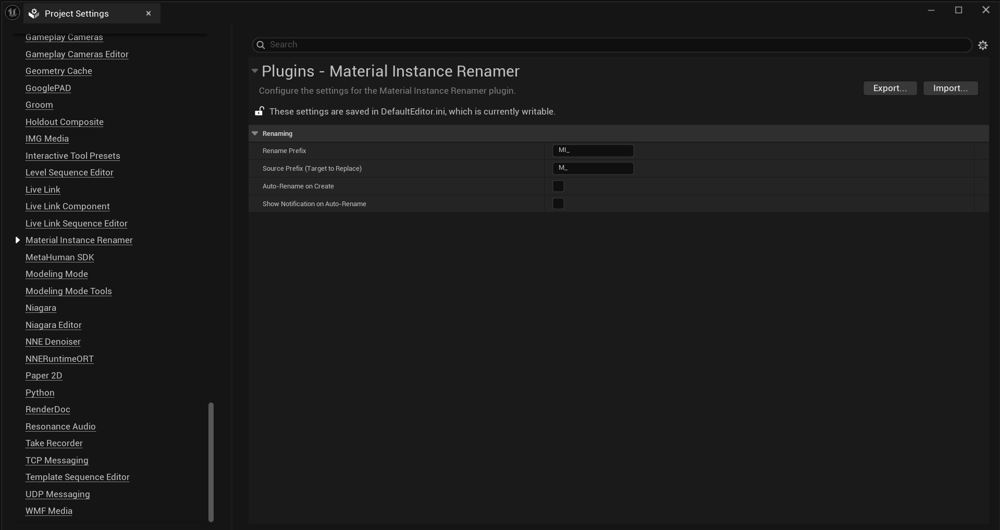
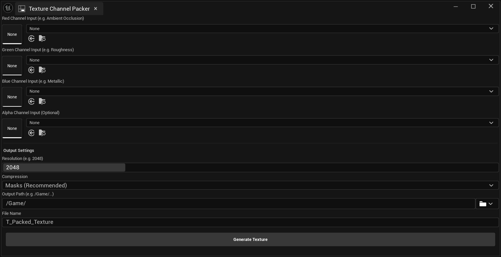
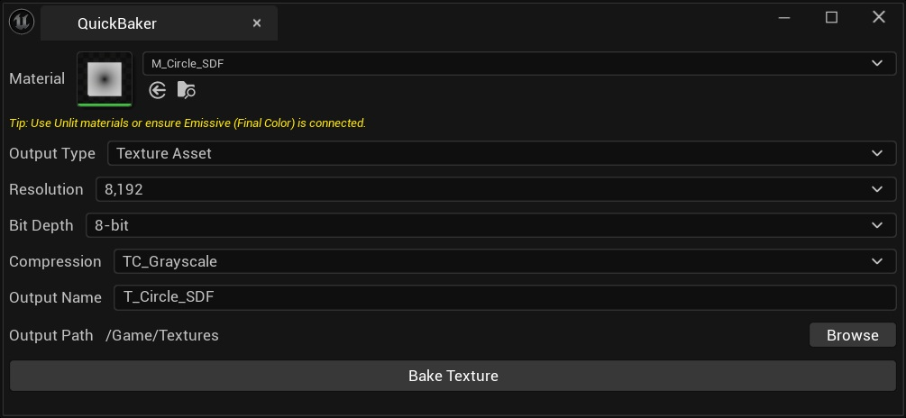
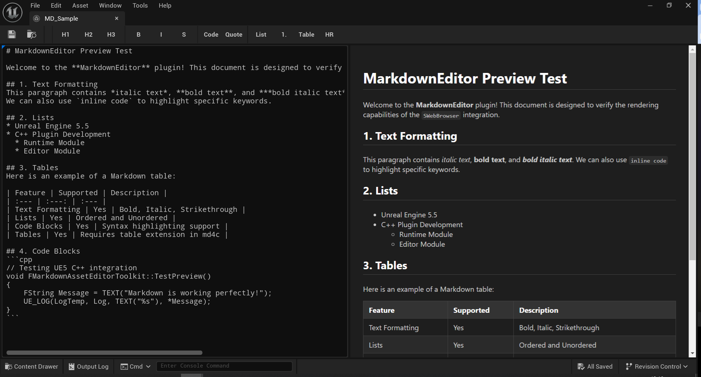

**[日本語ページはこちら (Japanese)](/ja/)**

Hello! I am **Kurorekishi**. While I work professionally as a **Lead Programmer using Cocos Creator (TypeScript)**, my personal focus and passion lie in **Unreal Engine 5 Tool Development** and **Technical Art**.

I specialize in bridging the gap between engineering and art, developing robust editor tools and creating visually striking procedural content using **C++, UE5, HLSL, and Python**.

With a strong focus on **asset management, workflow optimization**, and **tool development**, I strive to create environments where artists can work efficiently and creativity can flourish.

## Technical Skills

**Game Engines**

**Languages**

**Tools & DevOps**

**Specialties**
* Editor Tool Development
* Procedural Material / Technical Art
* Workflow Optimization & Team Leadership

## Work Experience Highlights
- Lead Programmer - Cocos Creator / TypeScript (7 engineers, 25-person team)
- CI/CD Pipeline Implementation (Jenkins, build optimization)
- Artist/Planner Coordination & Workflow Optimization
- Junior Developer Training (2 developers, 3-month program)

## Engine Contributions

### Unreal Engine 5 Source Code
**[PR #14424: Fix missing Convert node in Material Editor context menu (Under Review)](https://github.com/EpicGames/UnrealEngine/pull/14424)**
*Note: Access to the Epic Games repository is required to view this link.*

Identified a regression bug in the Material Editor occurring in UE5.6/5.7 and submitted a C++ patch (Pull Request) to the official repository.

* **Issue:** A regression where the Convert node was excluded from search candidates when dragging from a numeric output pin and searching for "Break" or similar.
* **Root Cause Identification:** Identified that the engine's node search validation (`HasCompatibleConnection`) references static type information from the CDO (Class Default Object), whereas the new specification of `UMaterialExpressionConvert` generates pins dynamically at runtime, causing type information to be missing on the CDO and resulting in exclusion from candidates.
* **Solution:** Added logic to the C++ engine code to bypass the CDO check for the target node as a special case when the source pin is of a numeric type (`MCT_Numeric`).

## Projects

### 1. [ProceduralDrawingMaterialSamples](https://github.com/EmbarrassingMoment/ProceduralDrawingMaterialSamples)
**UE5 Sample Project / Technical Art**

  

    <video src="/assets/images/procedural/radar.mp4" autoplay loop muted playsinline aria-label="Radar" style="width: 100%; border-radius: 4px;"></video>
    
Radar Sweep

  

  

    <video src="/assets/images/procedural/old-tv.mp4" autoplay loop muted playsinline aria-label="Old TV" style="width: 100%; border-radius: 4px;"></video>
    
Retro TV Effect

  

  

    <video src="/assets/images/procedural/page-curl.mp4" autoplay loop muted playsinline aria-label="Page Curl" style="width: 100%; border-radius: 4px;"></video>
    
Page Curl Transition

  

  

    <video src="/assets/images/procedural/snow.mp4" autoplay loop muted playsinline aria-label="Snow" style="width: 100%; border-radius: 4px;"></video>
    
Snow Crystal

  

A collection of textureless procedural material samples demonstrating advanced shader techniques.
*   **Key Features:** Includes diverse effects such as radar, animations, snowflakes, and transitions.
*   **Community:** Highly regarded with 160+ stars and 15 forks on GitHub.
*   **License:** MIT License.

### 2. [MIRenamer](https://github.com/EmbarrassingMoment/MIRenamer)
**UE5 Plugin / Workflow Automation**

  

    <video src="/assets/images/mirenamer/workflow.mp4" autoplay loop muted playsinline aria-label="Batch Renaming Demo" style="width: 100%; border-radius: 4px;"></video>
    
Batch Renaming Demo

  

  

    
    
Context Menu Integration

  

A powerful plugin for automating the naming of Material Instance assets with intelligent pattern recognition and customizable prefixes.
*   **Key Features:** Batch renaming, auto-rename on creation, command-line support (Commandlet), and multi-language UI (English/Japanese).
*   **Technical Highlights:** Context menu integration, asset registry scanning, intelligent base name extraction from multiple naming patterns, and CI/CD pipeline support.
*   **Distribution:** Available on [Fab](https://www.fab.com/listings/0523dde6-2cc5-4129-9d83-78584910d5a5).

### 3. [TextureChannelPacker (RGBPackingTool)](https://github.com/EmbarrassingMoment/RGBPackingTool)
**UE5 Plugin / Asset Optimization**

  

    <video src="/assets/images/texturechannelpacker/workflow.mp4" autoplay loop muted playsinline aria-label="Workflow Demo" style="width: 100%; border-radius: 4px;"></video>
    
Workflow Demo

  

  

    
    
UI Overview

  

A high-performance utility for packing grayscale textures into RGBA channels, essential for optimizing game assets and creating industry-standard texture maps.
*   **Key Features:** Packs up to four textures into one RGBA asset with a per-slot source channel selector and invert toggle, built-in and custom presets (ORM, MRA), a live preview of the packed result, an Unpack mode that splits a packed texture back into separate channels, non-square output up to 16384, and multi-language UI (English/Japanese).
*   **Technical Highlights:** Multi-threaded resizing and conversion, extended format support including 16-bit grayscale and 32-bit float (SDF) sources, cancellable progress dialog, and intelligent default handling (black for RGB, white for Alpha).
*   **Requirements:** UE5.5 – 5.8, Windows / Mac / Linux.
*   **Distribution:** Available on [Fab](https://www.fab.com/listings/7b231ecc-079f-45dc-9b8e-45dacc6b0771).
*   **License:** MIT License.

### 4. [QuickBaker](https://github.com/EmbarrassingMoment/QuickBaker)
**UE5 Plugin / Material Baking**

  

    <video src="/assets/images/quickbaker/workflow.mp4" autoplay loop muted playsinline aria-label="Baking Workflow" style="width: 100%; border-radius: 4px;"></video>
    
Baking Workflow

  

  

    
    
UI Overview

  

A lightweight editor tool designed to streamline the conversion of dynamic material expressions into static textures. It enables efficient baking of procedural noise, Signed Distance Fields (SDFs), and LUTs directly within the engine.
*   **Key Features:** Supports direct-to-asset baking (.uasset) and disk export (PNG/EXR), high-precision 16-bit float output, and workflow optimizations such as auto-naming and directory management.
*   **License:** MIT License.
*   **Distribution:** Available on [Fab](https://www.fab.com/listings/b53f5488-9b96-43cd-9963-e9fedafb56e9).
*   **Earlier Work:** [MaterialBaker](https://github.com/EmbarrassingMoment/MaterialBaker), a queue-based baking plugin that bakes multiple material properties (Base Color, Normal, Opacity, Emissive). Its development is currently frozen.

### 5. [MarkdownAssetProject](https://github.com/EmbarrassingMoment/MarkdownAssetProject)
**UE5 Plugin / Editor Tool**

  

    
    
Editor Overview

  

  

    <video src="/assets/images/md/live-preview.mp4" autoplay loop muted playsinline aria-label="Live Preview" style="width: 100%; border-radius: 4px;"></video>
    
Live Preview

  

An Unreal Engine plugin that introduces a custom Markdown asset type with a live HTML preview editor.
*   **Key Features:** Dual-pane editor with real-time preview, an outline panel for jumping between headings, find & replace, wikilinks (`[[AssetName]]`) and links to any Content Browser asset, project texture previews with clipboard image paste, dark/light preview themes, GitHub Flavored Markdown support (tables, task lists, strikethrough), Blueprint node support (`GetParsedHTML`, `GetRawMarkdownText`, `GetPlainText`), and English/Japanese editor UI.
*   **Technical Highlights:** Fast C-based Markdown-to-HTML conversion (md4c), `.md` import/export with reimport, optional `.pdf` / `.docx` / `.pptx` / `.html` import through Microsoft's markitdown, undo/redo integrated with the editor transaction system, and raw HTML disabled by default to prevent XSS.
*   **Requirements:** UE5.5+, C++ project.
*   **License:** MIT License.
*   **Distribution:** Available on [Fab](https://www.fab.com/listings/21ba464a-d8fa-48f5-833d-6894dbe9fe95).

### 6. [TransitionFX](https://github.com/EmbarrassingMoment/TransitionFX_Dev)
**UE5 Plugin / Screen Transition Effects**

  

    
    
Iris Transition

  

  

    
    
Spiral Transition

  

A lightweight UE5 plugin providing 30 procedural screen transition effects rendered via SDF math — no textures required. Designed for ease of use with a single Blueprint node and a data-driven preset system.
*   **Key Features:** 30 built-in effects (Fade, Iris, Spiral, Hexagon, Dissolve, TV Switch Off, and more), data-driven preset assets, latent Blueprint nodes, `Open Level With Transition` for fade-out → level load → fade-in in one node, sequence playback that chains multiple transitions, GameInstance Subsystem for cross-level persistence, automatic input blocking, and audio sync support.
*   **Technical Highlights:** Two rendering paths switchable per preset — texture-free SDF rendering via PostProcess, or a full-screen widget layer that also covers UMG/Slate UI (15 widget-layer variants) — plus 13 easing curves, Forward/Reverse/Invert playback modes, dynamic speed control, an event delegate system, and an editor preview tool with scrubbing and built-in GIF capture.
*   **Requirements:** UE5.5+, Windows (DX12 SM6). Works with both Blueprint-only and C++ projects.
*   **License:** MIT License.
*   **Distribution:** Available on [Fab](https://www.fab.com/listings/82f9a51f-52e6-4a01-a637-43a4dac76c0a).

### 7. [LoadingFX](https://github.com/EmbarrassingMoment/LoadingFX_Dev)
**UE5 Plugin / Loading Indicators**

  

    
    
Bundled Spinners &amp; Bars

  

  

    
    
Loading Icon During Map Travel

  

A loading indicator plugin for UE5: a library of procedural spinners and loading bars, a project-wide loading icon that can be shown and hidden from anywhere, and a lightweight asset loader with progress.
*   **Key Features:** 18 spinners and 3 loading bars built as texture-free SDF materials, a reference-counted loading icon subsystem (Blueprint / C++) that survives map travel, show delay and minimum display time to prevent flicker, UMG spinner and progress bar widgets, and an asynchronous asset loader with progress and cancel.
*   **Technical Highlights:** Keeps the icon animating while the game thread is blocked (`OpenLevel`, synchronous loads) by rendering it through the engine's MoviePlayer, and splits the icon and the loader into independent runtime modules connected by an optional bridge module.
*   **Requirements:** UE5.5 – 5.8, Windows (Linux compile-checked). Works with both Blueprint-only and C++ projects.
*   **License:** MIT License.
*   **Distribution:** Available on [Fab](https://www.fab.com/listings/8907b7ec-4db6-4bd4-9f98-2052f3f23032).

## Technical Writing

* **[UE5] Implementing a Circular Wipe Transition** - Qiita
    * A technical guide on creating a circular wipe post-process effect in Unreal Engine 5.
    * [Read on Qiita (Japanese)](https://qiita.com/EmbarrassingMoment/items/11e74b18a5488e84757d)

## GitHub Activity

* **UE5 plugins:** 6 published on GitHub, all of them also distributed on [Fab](https://www.fab.com/sellers/kurorekishi).
* **Most starred:** [ProceduralDrawingMaterialSamples](https://github.com/EmbarrassingMoment/ProceduralDrawingMaterialSamples) and [TransitionFX](https://github.com/EmbarrassingMoment/TransitionFX_Dev).

## Contact & Links

*   **GitHub:** [EmbarrassingMoment](https://github.com/EmbarrassingMoment)
*   **Twitter/X:** [@endwar1338](https://x.com/endwar1338)
*   **Fab:** [My Listings](https://www.fab.com/sellers/kurorekishi)

---
[<i class="fab fa-github"></i> View My GitHub Profile](https://github.com/EmbarrassingMoment){: .btn .btn--primary .btn--large}
